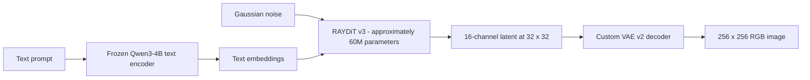

<!-- RAY-IMAGE README: model overview, release status, engineering history, and reproducibility notes. -->

  

  
  
  
  
  

<h1 align="center">RAY-IMAGE</h1>

  <strong>A from-scratch text-to-image research project — from toy latent experiments to a trained ~60M-parameter Diffusion Transformer.</strong>
   
  Custom VAE · DiT v3 · Flow Matching · Qwen3-4B Text Conditioning · Classifier-Free Guidance

  <a href="#-the-60m-release-milestone">Release milestone</a> ·
  <a href="#-architecture">Architecture</a> ·
  <a href="#-engineering-timeline">Engineering timeline</a> ·
  <a href="#-what-the-model-can-and-cannot-do">Results and limits</a> ·
  <a href="#-reproduce-and-inspect">Reproduce and inspect</a>

---

## 🔍 The 60M release milestone

**RAY-IMAGE is an independent attempt to build a text-to-image system from its underlying components, train it under limited compute, and document the engineering rather than hide the failures.** The project has progressed from toy-image VAE/DiT experiments to a real-image pipeline using a custom 16-channel VAE, a ~60M-parameter DiT v3, cached Qwen text embeddings, flow-matching training, and a CFG-capable sampling path.

The project training record reports that **DiT v3 reached 300,000 optimizer steps** using a stability-focused training recipe. The current sample gallery shows genuine outputs from the project across ten text prompts. The result is a meaningful engineering milestone, but not a claim that RAY-IMAGE can yet generate consistently recognizable objects or compete with established image-generation systems.

### Release summary

| Area | Current project state |
|---|---|
| **Model being shipped** | RAY-IMAGE DiT v3, approximately 60M parameters |
| **Reported training milestone** | 300,000 optimizer steps; the step count is not a count of unique images |
| **Latent autoencoder** | Custom VAE v2, 16 latent channels at 32 × 32 for 256 × 256 RGB images |
| **Text conditioning** | Frozen Qwen3-4B encoder; 2,560-dimensional hidden states |
| **Training objective** | Flow matching / velocity prediction |
| **Sampling** | Euler integration; optional classifier-free guidance (CFG) |
| **Stability work** | Learning-rate warmup, gradient clipping, NaN/finite-value guards, checkpoint provenance and resume validation |
| **Conditioning and averaging** | Caption dropout, a validated null-prompt path, and exponential moving average (EMA) code |
| **Observed output** | Experimental, often impressionistic or abstract; object geometry and consistent prompt adherence remain weak |
| **Release classification** | Experimental research release, not a production-ready image generator |

### Artifact availability — read before downloading

- **Current N8 v3 / ~60M model repository:** [Rishix500/ray-image-dit-n8-v3](https://huggingface.co/Rishix500/ray-image-dit-n8-v3). Hugging Face currently marks this repository **private**, so a link to it does not mean the 300k checkpoint is publicly downloadable. Access depends on the repository's visibility and permissions.
- **Previously published model artifact:** [Rishix500/ray-image-dit-n8-v2](https://huggingface.co/Rishix500/ray-image-dit-n8-v2).
- **Cached training data:** [Rishix500/monet-qwen-cache-200k](https://huggingface.co/datasets/Rishix500/monet-qwen-cache-200k).
- **VAE artifact referenced by the training code:** [Rishix500/ray-image-vae-n8](https://huggingface.co/Rishix500/ray-image-vae-n8).
- **Hugging Face profile:** [Rishix500](https://huggingface.co/Rishix500).

To describe this as a fully public model release, the intended v3 checkpoint, matching VAE, and required auxiliary artifacts must be accessible to the intended users. Checkpoints are stored outside Git because of their size. Do not assume that a public code repository means every model weight or cache is public.

## 🖼️ What the current sample grid shows

The image above collects outputs for prompts such as golden-hour desert dunes, a deep-space nebula, stormy ocean waves, an enchanted forest, a volcanic eruption, cherry-blossom trees beside a lake, a neon alleyway, an autumn forest, an arctic glacier, and abstract watercolor.

The gallery is a set of **actual experimental model outputs**, not an architecture diagram. It is useful for seeing the model's current visual tendencies across different prompts. It is **not** a controlled benchmark: there is no claim here of measured CLIP alignment, FID, production-level quality, or consistent generalization to arbitrary prompts.

The observed pattern is that broad color, atmosphere, texture, and impressionistic composition can appear, while object structure and geometry are frequently not recognizable enough. That gap is the central research problem for the next iteration.

## ◈ Architecture

### Target generation path

The diagram describes the intended v3 generation route. A checkpoint, VAE, latent-space convention, text-conditioning shape, and architecture configuration must match for inference. Not every historical checkpoint is compatible with the current generation entry point.

### Model components

| Component | Design and role | Source |
|---|---|---|
| **VAE v2** | Custom encoder/decoder; 256 × 256 RGB image to a 16 × 32 × 32 latent and back | [ray_image/vae_v2.py](ray_image/vae_v2.py) |
| **DiT v3** | 512 model width, 12 transformer blocks, 8 attention heads, patch size 2; RoPE self-attention, RMSNorm, SwiGLU and gated text cross-attention | [ray_image/dit_v3.py](ray_image/dit_v3.py) |
| **Text encoder** | Frozen Qwen3-4B representations with 2,560 hidden dimensions; optional 8-bit loading | [ray_image/text_encoder.py](ray_image/text_encoder.py) |
| **Flow matching** | Linear interpolation between data latents and Gaussian noise; velocity-prediction objective | [ray_image/flow.py](ray_image/flow.py) |
| **Caption dropout / null prompt** | Replaces a proportion of training conditions with a null placeholder so unconditional and conditional predictions can be combined | [ray_image/cfg.py](ray_image/cfg.py) |
| **EMA** | Maintains an exponential moving average of DiT weights for a smoother inference candidate | [ray_image/cfg.py](ray_image/cfg.py) |
| **Training** | Streams MONET examples or reads precomputed latents and text embeddings; validates resume configuration and protects checkpoint writes | [ray_image/train_dit_v3.py](ray_image/train_dit_v3.py) |
| **Cache builder** | Precomputes VAE latents and Qwen hidden states in chunks to reduce repeated encoder work during training | [ray_image/precompute_qwen_cache.py](ray_image/precompute_qwen_cache.py) |
| **Inference** | Loads compatible v3 checkpoints, optionally uses EMA and CFG, and checks checkpoint/latent whitening metadata | [ray_image/generate.py](ray_image/generate.py) |

### Training recipe recorded in the code

| Setting | Value or behaviour |
|---|---|
| Training resolution | 256 × 256 RGB |
| Latent tensor | 16 channels × 32 × 32 |
| DiT width / depth / heads | 512 / 12 / 8 |
| Base learning rate | 5e-5 |
| Warmup | 500 steps |
| Gradient clipping | Maximum norm 1.0 |
| Training precision | DiT forward path uses FP16 |
| Caption dropout | Default probability 0.10 |
| EMA decay | Default 0.999 |
| Checkpoint/log cadence | 500 / 100 steps in the current training script |
| Data source | MONET (jasperai/monet) or precomputed cache |
| Cached text shape | Dataset card describes 47 × 2,560 text embeddings per cached item |

These settings describe the current code/configuration and the recipe recorded in the project audit. They are not a claim that every run has identical environments or bit-for-bit reproducibility.

## 🧱 Engineering timeline

### 1. Foundation: toy latents and shape probes (N0–N7)

The first stages focused on proving the model path with toy images and simple coloured shapes before using real images. The VAE path evolved from a smaller four-channel latent setup to a 16-channel representation for the 256-pixel pipeline.

A low shape-accuracy score initially pointed attention at the model, but a probe exposed a problem in the evaluation metric: corner occupancy was measured against the whole image instead of the object bounding box. The lesson was not to trust a score until the measurement is calibrated against the image geometry it is supposed to measure.

### 2. Scaling to real images (N8)

The project moved to the MONET image-caption dataset and a 256 × 256 path. VAE v2 and its 47,500-step checkpoint became part of the training pipeline.

The first larger DiT v2 experiment, approximately 180M parameters, reportedly diverged into NaNs around 12,000 steps. That consumed significant iteration time and showed that parameter count alone does not make a training run better. The project moved to a smaller DiT v3 and focused on stability before further scaling.

### 3. Rebuilding the training recipe around DiT v3

The current v3 code uses a smaller model with RMSNorm, SwiGLU, RoPE self-attention, FP16 forward computation, warmup, gradient clipping, and NaN/finite-checkpoint guards. The project run notes report successful progression through 100k, 200k, and 300k steps.

This should be read as evidence that the reported training run progressed to those milestones—not evidence that the generated images are already high quality. A loss curve or a successful optimizer loop cannot substitute for a held-out image-quality evaluation.

### 4. Building the latent/text cache pipeline

The data path precomputes VAE latents and Qwen text embeddings so that repeated DiT training steps do not need to run both encoders on every image. The cache builder supports resumable 10,000-sample chunks and range-selection arguments.

Two issues shaped this part of the project:

- A brittle source-code string replacement intended to alter a stream offset did not match the actual numeric formatting. It was replaced by explicit chunk/range command-line arguments.
- The project notes report a corrupted MONET Parquet shard around source position 191k. The affected 190k–200k range was skipped instead of silently treated as valid cache data. The cache pipeline can handle individual failures, but upstream dataset integrity remains an external dependency.

The public cache repository is a separately hosted artifact; it is not bundled in this Git repository.

### 5. Adding conditioning and sampling controls

The current code includes caption dropout, a null-prompt embedding path, EMA tracking, and CFG sampling. These changes address real training/inference gaps: CFG requires an unconditional path learned during training, and sampling must use conditioning and latent transformations consistently with the checkpoint.

The code also logs a zero-prediction MSE baseline so loss values can be interpreted against a simple reference. This helps diagnose optimisation behaviour, but it is not a measure of semantic alignment or image quality.

### 6. Hardening checkpoints and the inference path

The repository includes multiple defensive changes:

- checkpoint configuration records architecture and provenance information such as latent-space convention, text cap, VAE checkpoint, PyTorch version, and run identity;
- resume validation checks that essential architecture fields match the checkpoint before training continues;
- latent un-whitening is applied only when the checkpoint stores the corresponding whitening state, rather than guessing from a default stats file;
- the generation path explicitly refuses the known-incompatible legacy `generator_v0.3` stage;
- NaN and non-finite checks help prevent corrupted weights from being saved;
- checkpoint cleanup uses separate windows for full resume checkpoints and EMA checkpoints.

These safeguards improve diagnosis and reduce avoidable incompatibility. They do not guarantee that an arbitrary external checkpoint will load or produce good images.

## 🧰 Mistakes, fixes, and lessons learned

| Failure or risk | Root cause / impact | Engineering response |
|---|---|---|
| **DiT v2 divergence** | The larger ~180M experiment became numerically unstable; the reported run hit NaNs near 12k steps | Moved to v3 and adopted a stability-first recipe: lower learning rate, warmup, gradient clipping, RMSNorm, SwiGLU, FP16 and finite-value guards |
| **Uncalibrated toy evaluator** | The shape metric's corner-occupancy logic did not measure the object geometry correctly | Added a shape probe and corrected the interpretation of the score before using it to judge model behaviour |
| **Silent cache-range edit failure** | String replacement missed a source expression because of numeric formatting | Replaced hidden source edits with explicit chunk-range CLI arguments |
| **Missing unconditional training path in an earlier recipe** | CFG requires training examples with dropped conditions and a defined null prompt | Added caption dropout, null-prompt handling, EMA and a CFG-capable sampler to the current code path |
| **Latent whitening mismatch** | Training and generation could disagree about whether latents were raw or transformed | Record latent-space provenance and reject unverifiable or contradictory whitening transformations |
| **Legacy model-construction mismatch** | Old generator stages and current v3 model contracts were not interchangeable | Explicitly refuse the unsupported legacy stage and use a matching VAE/DiT route |
| **Qwen placement on constrained multi-GPU sessions** | Automatic device mapping could distribute the text encoder unexpectedly in the Kaggle setup | Configure the text encoder for the intended single-device path and document setup assumptions |
| **Kaggle package/ABI drift** | Installed PyTorch, torchvision and Transformers versions could disagree or leave stale modules in a live kernel | Document the environment-reset and package setup procedure in [KAGGLE_SETUP.md](KAGGLE_SETUP.md) |
| **Credentials and ephemeral sessions** | Environment variables do not survive fresh hosted sessions, and credentials should not be written into source or logs | Load secrets from environment variables at session start; never commit tokens or print them |
| **Ambiguous checkpoints** | A weight file without stage/config provenance can be loaded through the wrong architecture | Store metadata, validate resume configuration and retain separate names for full and EMA checkpoints |

## 📊 What the results mean — and do not mean

### What has been achieved

- A custom VAE v2 and a larger latent representation for the 256 × 256 image-generation path.
- A custom, text-conditioned DiT v3 architecture with a reported size of roughly 60M parameters.
- A cached data route for VAE latents and Qwen text embeddings.
- Training code with flow matching, caption dropout, null-prompt handling, EMA, gradient clipping and numerical guards.
- A generation entry point with optional CFG and EMA loading for compatible v3 checkpoints.
- Checkpoint provenance/resume checks, latent-whitening validation and CPU smoke modules wired into GitHub Actions.
- A reported 300,000-step training milestone and a ten-prompt gallery showing real experimental outputs.

### What has not been demonstrated yet

- Consistently recognizable faces, animals, everyday objects or exact scene geometry.
- A reproducible benchmark showing prompt adherence or quality against established generators.
- CLIP-score or FID evaluation on a fixed, held-out prompt/image set.
- Published PSNR/SSIM measurements for VAE reconstruction quality.
- Bit-for-bit reproducibility across restarts and environments.
- Stable, production-ready performance for every prompt, checkpoint, or hardware setup.

### The latent-resolution bottleneck

The current VAE compresses a 256 × 256 image into a 16 × 32 × 32 latent tensor. That compact spatial grid is a plausible constraint on fine geometry and small-object detail, and the current samples show weak object recognizability. This is an engineering hypothesis supported by the observed output pattern—not a proven mathematical ceiling. The next experiments need controlled comparisons to establish whether greater spatial resolution, different data/conditioning, training changes, or a combination gives measurable improvement.

## 🔬 Reproducibility and open technical risks

The project is experimental research code. Important remaining risks are documented rather than hidden:

1. **EMA on resume:** the current training code recreates EMA from the resumed model weights instead of restoring the saved EMA state. A resumed run therefore does not continue the exact previous EMA trajectory.
2. **Random-state reproducibility:** the checkpoint records a seed and run metadata, but the project audit notes that full RNG state is not persisted for bit-for-bit continuation.
3. **Caption-length analysis:** the cache uses a 47-token text representation. Caption-length percentiles and the impact of truncation have not yet been measured systematically.
4. **Mixed-precision scaling:** no GradScaler path is documented in the current recipe; NaN guards reduce some risks but do not replace a precision/evaluation study.
5. **Dataset integrity:** the reported corrupted upstream Parquet range was skipped. Future runs should validate cache completeness and source ranges instead of assuming every range exists.
6. **Evaluation:** there is no complete CLIP/FID benchmark harness or fixed held-out evaluation protocol in this release.
7. **Dependency pinning:** requirements specify minimum package versions rather than a fully locked environment. Exact reproduction requires recording actual versions, hardware and run settings.
8. **Checkpoint access:** N8 v3 is currently private on Hugging Face. Public code, public examples and downloadable model weights are separate release concerns.

## 🤗 Models and datasets

- **Current ~60M DiT v3 artifact (private at time of writing):** [ray-image-dit-n8-v3](https://huggingface.co/Rishix500/ray-image-dit-n8-v3)
- **Earlier model artifact:** [ray-image-dit-n8-v2](https://huggingface.co/Rishix500/ray-image-dit-n8-v2)
- **MONET + Qwen cache:** [monet-qwen-cache-200k](https://huggingface.co/datasets/Rishix500/monet-qwen-cache-200k)
- **VAE checkpoint repository:** [ray-image-vae-n8](https://huggingface.co/Rishix500/ray-image-vae-n8)
- **Author profile:** [Rishix500 on Hugging Face](https://huggingface.co/Rishix500)

Large weights, caches and runtime artifacts intentionally live outside Git. A link to an artifact is a location reference, not a claim that its files are public or that all referenced checkpoints are mutually compatible.

## ⚙️ Reproduce and inspect

### 1. Clone the repository

~~~bash
git clone https://github.com/Rishidev-20thcenturey/rustes-generative-ai.git
cd rustes-generative-ai
~~~

### 2. Prepare Python

The GitHub Actions workflow uses Python 3.11. GPU runs additionally require a compatible PyTorch/CUDA environment, sufficient GPU memory, access to the Hugging Face assets, and—when downloading or uploading private artifacts—a valid HF token supplied through the environment.

~~~bash
python -m venv .venv
source .venv/bin/activate
python -m pip install --upgrade pip
python -m pip install -r requirements.txt
~~~

For hosted Kaggle sessions, read [KAGGLE_SETUP.md](KAGGLE_SETUP.md) before installing or importing the ML stack. Incompatible preinstalled binary wheels and stale notebook-kernel imports caused repeated environment failures during development. Follow the documented restart and dependency steps rather than assuming a fresh session starts with a compatible environment.

### 3. Run the CPU smoke checks

Run from the repository root after installing dependencies. These are small behaviour and wiring checks; they do not train the model or certify image quality.

~~~bash
python -m ray_image.train_smoke
python -m ray_image.probe_smoke
python -m ray_image.whiten_smoke
python -m ray_image.probe_text_smoke
python -m ray_image.n4_smoke
python -m ray_image.n5_smoke
python -m ray_image.resume_smoke
python -m ray_image.cfg_smoke
~~~

The workflow definition is [.github/workflows/test.yml](.github/workflows/test.yml). Check the live Actions badge for the current status; the existence of a workflow is not, by itself, proof that the latest run passed.

### 4. Inspect the training interfaces

~~~bash
python -m ray_image.train_vae_v2 --help
python -m ray_image.train_dit_v2 --help
python -m ray_image.train_dit_v3 --help
python -m ray_image.precompute_qwen_cache --help
~~~

The v3 trainer requires CUDA. Use its current CLI for cache ranges, checkpoint resume, save paths and step targets. Do not hard-code a dataset offset through source-string replacement; inspect the intended range and use the supported arguments.

### 5. Generation interface

A matching v3 EMA checkpoint, the corresponding VAE checkpoint, text-conditioning artifacts and compatible runtime are required. This example shows the interface; it is not a claim that any arbitrary set of downloaded files will work:

~~~bash
python -m ray_image.generate \
  --checkpoint /path/to/ray_dit_v3_ema_step_0300000.pt \
  --use-ema \
  --vae-checkpoint /path/to/ray_vae_v2_step_0047500.pt \
  --prompt "a watercolor harbour at dusk" \
  --cfg-scale 3.0 \
  --steps 40 \
  --seed 42 \
  --output generated.png
~~~

For CFG, the sampler needs the null-prompt embedding path. The v3 loader checks checkpoint stage and latent-space metadata; use the matching checkpoint/VAE pair and follow the error messages rather than bypassing compatibility checks.

## 🗺️ Roadmap — proposed work, not completed work

The next phase should measure whether more spatial information and controlled training changes improve recognisable geometry before scaling the model blindly.

- **Higher-resolution VAE experiment:** train and evaluate a 512 × 512-capable VAE path, including reconstruction measurements.
- **Higher-resolution cache:** build and validate matching VAE/text caches with explicit source-range accounting.
- **~100M DiT experiment:** test a larger model at the higher latent resolution using controlled training settings and fixed evaluation prompts.
- **Evaluation harness:** add a reproducible held-out prompt set and objective metrics such as CLIP-based alignment, plus a documented human review protocol.
- **Resume hardening:** persist and restore EMA and RNG states where practical.
- **Release hardening:** make the intended checkpoint and companion artifacts accessible, add a model card with limitations and intended use, and document compatible versions and inference steps.

A 100M / 512 experiment and anime-specific adaptation are **future plans**, not capabilities of the current 60M release. Higher resolution may help with detail, but recognizable output is not guaranteed without evidence from experiments.

## 🗂️ Repository map

~~~text
.
├── ray_image/
│   ├── vae.py, vae_v2.py
│   ├── dit.py, dit_v2.py, dit_v3.py
│   ├── text_encoder.py, flow.py, whiten.py, cfg.py
│   ├── train_vae_v2.py
│   ├── train_dit_v2.py, train_dit_v3.py
│   ├── precompute_qwen_cache.py, generate.py
│   ├── probe_*.py, *_smoke.py
│   └── resume_smoke.py
├── notebooks/
├── runs/N5.1/                 # diagnostic report and oracle artifacts
├── tools/                     # toy data and evaluation helpers
├── assets/ray-image-hero.svg  # architecture/project illustration
├── Screenshot_20261023-175533 (2).png
├── .github/workflows/test.yml
├── KAGGLE_SETUP.md
├── PROJECT_STATE.md           # older phase snapshot
└── REPO_AUDIT_README.md       # dated audit report
~~~

Some source modules represent earlier research phases and are retained for historical comparisons. The v3 route is the current real-image training path; legacy modules and checkpoints should not be mixed with it without checking architecture and stage metadata.

## 📚 Engineering principles learned

1. **Calibrate metrics before interpreting them.** An incorrect evaluator can misdiagnose a model.
2. **Prove stability before scaling.** A smaller model that trains is more useful than a larger model that diverges.
3. **Make data ranges explicit.** Chunk boundaries, cached counts, skipped samples and corruption need auditable records.
4. **Treat training and inference as one contract.** VAE version, latent scaling, text dimensions, checkpoint stage and CFG setup must agree.
5. **A successful run is not a quality benchmark.** Training completion, valid tensor shapes, CPU smoke tests and visually appealing examples each prove different things.
6. **Document the failure, not only the fix.** Setup drift, broken shards, resume limitations and weak geometry are part of the engineering record.

## Contact

For RAY-IMAGE questions, research feedback or technical collaboration:

**Email:** [rishirajc406@gmail.com](mailto:rishirajc406@gmail.com)

---

  <strong>Build carefully. Measure honestly. Scale when the evidence is ready.</strong>
   
  RAY-IMAGE · Independent text-to-image research under constrained compute

