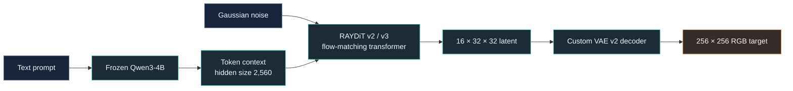

<!-- RAY-IMAGE README: product overview, research status, and reproducibility guide. -->

<p align="center">
  
</p>

<p align="center">
  <a href="https://github.com/Rishidev-20thcenturey/-rustes-generative-ai/actions/workflows/test.yml"></a>
  <a href="https://huggingface.co/Rishix500"></a>
  
  
  
</p>

<h1 align="center">RAY-IMAGE</h1>

<p align="center">
  <strong>A from-scratch text-to-image research stack — built around careful experiments, not unsupported claims.</strong>
  <br />
  Custom VAE · Diffusion Transformer (DiT) · Flow Matching · Frozen Qwen Text Conditioning
</p>

<p align="center">
  <a href="#-at-a-glance">At a glance</a> ·
  <a href="#-architecture">Architecture</a> ·
  <a href="#-research-status">Research status</a> ·
  <a href="#-hugging-face-hub">Hugging Face Hub</a> ·
  <a href="#-run-the-smoke-checks">Run smoke checks</a> ·
  <a href="#-limitations-and-reproducibility">Limitations</a>
</p>

---

## What is RAY-IMAGE?

**RAY-IMAGE is an ongoing attempt to build an image generator from the underlying components up.** The repository contains custom variational autoencoders (VAEs), multiple Diffusion Transformer (DiT) variants, a flow-matching training path, text-conditioning experiments, cache tooling, checkpoint-resume safeguards, and diagnostic smoke checks.

The project is deliberately developed under tight compute limits. Its guiding rule is simple: **measure a failure before trying to train it away.** Architecture changes, training runs, checkpoint metadata, and evaluation assumptions should be inspectable rather than hidden behind a demo.

> **Research preview:** this repository is not a hosted image-generation service or a polished model release. The real-world pipeline is still under research; a training script or a model architecture is not, by itself, evidence of reliable image quality. The image above is a generated sample produced by RAY-IMAGE.

## ✦ At a glance

| Area | What is in this repository |
|---|---|
| **Goal** | Text-conditioned image generation using models trained from scratch |
| **Core generator** | Custom DiT v2 and DiT v3 architecture experiments |
| **Latent autoencoder** | Custom 16-channel VAE v2 targeting 256×256 RGB images |
| **Text conditioning** | Frozen Qwen3-4B hidden states, with 8-bit loading in the N8 path |
| **Training objective** | Flow matching / velocity prediction |
| **Data path** | MONET image-caption streaming and cached latent/text embeddings |
| **Engineering focus** | Resumable checkpoints, provenance metadata, smoke checks, and diagnostics |
| **Compute intent** | Workflows designed around constrained cloud-GPU sessions |
| **Release state** | Research preview; an experimental N8 v2 checkpoint is hosted separately, with no final quality-validated release or benchmark claimed here |

## ◈ Architecture

### Target image-generation path

The current codebase explores this end-to-end design. Compatibility between checkpoint stage, latent convention, VAE version, and DiT architecture matters; this diagram describes the intended current-generation path, not a guarantee that every checkpoint can be loaded by every entry point.



### Model components

| Component | Implementation notes | Main source |
|---|---|---|
| **VAE v2** | 256×256 RGB input → 16 channels at 32×32 spatial resolution; learned encoder and decoder | [`vae_v2.py`](ray_image/vae_v2.py) |
| **DiT v2** | Text-conditioned transformer; configured for 16-channel, 32×32 latents; configurable depth, width, heads, and cross-attention gate | [`dit_v2.py`](ray_image/dit_v2.py) |
| **DiT v3** | Smaller transformer variant using RoPE self-attention, RMSNorm, SwiGLU, and gated text cross-attention | [`dit_v3.py`](ray_image/dit_v3.py) |
| **Text encoder** | Frozen Qwen3-4B; 2,560-dimensional hidden states; optional 8-bit model loading | [`text_encoder.py`](ray_image/text_encoder.py) |
| **Flow matching** | Linear data/noise interpolation and Euler integration for sampling | [`flow.py`](ray_image/flow.py) |
| **VAE training** | MONET streaming, reconstruction/perceptual losses, PatchGAN component, resumable checkpoints | [`train_vae_v2.py`](ray_image/train_vae_v2.py) |
| **DiT training** | MONET streaming or cached latents/text embeddings; checkpointing and resume-validation logic | [`train_dit_v2.py`](ray_image/train_dit_v2.py), [`train_dit_v3.py`](ray_image/train_dit_v3.py) |
| **Cache builder** | Precomputes VAE latents and text representations for training runs | [`precompute_qwen_cache.py`](ray_image/precompute_qwen_cache.py) |

### What the variants mean

- **Foundation experiments (N0–N5.1):** small, deterministic toy-image experiments used to test the mechanics of the VAE, DiT, text-conditioning path, gated cross-attention, and evaluation logic.
- **Real-world path (N6–N8):** higher-resolution VAE work, MONET data, Qwen conditioning, latent caching, and larger DiT variants. This is the active research track; it should not be described as a finished, quality-validated public model.
- **Inference:** [`generate.py`](ray_image/generate.py) contains checkpoint-loading and sampling logic. It intentionally refuses the legacy `generator_v0.3` stage because its checkpoint assumptions are incompatible with the current loader. Use only a checkpoint whose architecture, stage, VAE, and latent-space metadata match the selected path.

## ◉ Research status

This table separates code that exists from outcomes that still require evidence.

| Workstream | Current repository evidence | Status |
|---|---|---|
| Toy architecture and diagnostic path | VAE/DiT modules, probes, toy evaluator, and smoke scripts are present | Implemented research foundation |
| N5.1 evaluation analysis | A diagnostic report documents a calibration issue and explains which real-image comparisons are still missing | Report available; historical results must be interpreted cautiously |
| 256×256 VAE v2 | Architecture and MONET-based training code are present | Implemented; checkpoint artifacts are stored outside Git |
| DiT v2 / DiT v3 | Architecture and flow-matching training code are present | Active research; architecture existence does not prove convergence |
| Cached-data pipeline | MONET cache builder and cache readers support chunked latent/text data | Implemented tooling; a cache build still depends on external data/model access |
| Resume and provenance safeguards | Checkpoint configuration validation and a CPU smoke script are present | Smoke-tested in CI on the corresponding development change |
| End-to-end image quality | No final benchmark suite or reproducible gallery is supplied by this README | Not claimed |
| Hugging Face artifact | An experimental N8 v2 checkpoint is hosted outside this Git repository | Published research artifact; not a final quality-validated release |

Useful project records:

- [N5.1 diagnostic report](runs/N5.1/REPORT.md) — a careful example of separating measured results from unverified visual claims.
- [Repository forensic audit](REPO_AUDIT_README.md) — a **dated, historical audit** of the inspected tree, including later addenda. It is not a live bug tracker; some listed items were addressed by subsequent changes.
- [CI smoke workflow](.github/workflows/test.yml) — the checks run on pushes and pull requests targeting `main`.
- [Project-state notes](PROJECT_STATE.md) — an older phase snapshot. Check the current code and commit history before relying on its milestone counts.

## 🤗 Hugging Face Hub

RAY-IMAGE's experimental model artifact and supporting training cache are hosted outside this Git repository on Hugging Face Hub.

- **Model artifact:** [`Rishix500/ray-image-dit-n8-v2`](https://huggingface.co/Rishix500/ray-image-dit-n8-v2)
- **Training cache:** [`Rishix500/monet-qwen-cache-200k`](https://huggingface.co/datasets/Rishix500/monet-qwen-cache-200k)
- **Hugging Face profile:** [`Rishix500`](https://huggingface.co/Rishix500)

The checkpoint is shared as an experimental research artifact, not as a finished or quality-validated model release. Hosted text-to-image inference is not currently enabled for this model; these links lead to the published artifacts and project profile.

## ⚙️ Get the code

### 1. Clone the repository

```bash
git clone https://github.com/Rishidev-20thcenturey/-rustes-generative-ai.git
cd -rustes-generative-ai
```

### 2. Prepare Python

The CI workflow uses Python 3.11. A GPU run also needs a PyTorch build and CUDA setup compatible with the machine or hosted notebook you are using.

```bash
python -m venv .venv
source .venv/bin/activate
python -m pip install --upgrade pip
python -m pip install -r requirements.txt
```

**Reproducibility note:** `requirements.txt` currently specifies minimum versions, not a fully locked environment. For repeatable experiments, record the Python/PyTorch/CUDA versions, GPU type, run seed, config, and checkpoint provenance alongside the results. Some checks and training paths also need network access to download pretrained LPIPS or Qwen assets.

### 3. Run the CPU smoke checks

Run these from the repository root after installing dependencies. They check small pieces of wiring and expected behavior; they are **not** a comprehensive model-quality test or a substitute for a real training run.

```bash
python -m ray_image.train_smoke
python -m ray_image.probe_smoke
python -m ray_image.whiten_smoke
python -m ray_image.probe_text_smoke
python -m ray_image.n4_smoke
python -m ray_image.n5_smoke
python -m ray_image.resume_smoke
```

The GitHub Actions workflow wires these smoke modules into CI. The workflow also initializes the LPIPS dependency before running its smoke steps.

### 4. Inspect the training interfaces

Use each script's built-in help before configuring a run:

```bash
python -m ray_image.train_vae_v2 --help
python -m ray_image.train_dit_v2 --help
python -m ray_image.train_dit_v3 --help
python -m ray_image.precompute_qwen_cache --help
```

Real-world training requires access to the configured Hugging Face dataset/model assets and suitable GPU memory. Check the script's current arguments and configuration constants rather than copying a command from an older notebook or project-state note. Never commit a Hugging Face token or other credentials to the repository.

## 🖼️ Inference interface

A generation entry point exists, but **checkpoint compatibility is essential**. This is an interface example for a compatible current-generation checkpoint, not a claim that arbitrary downloaded weights will work:

```bash
python -m ray_image.generate \
  --checkpoint /path/to/compatible-dit-checkpoint.pt \
  --vae-checkpoint /path/to/matching-vae-checkpoint.pt \
  --prompt "a quiet mountain valley beneath a star-filled sky" \
  --output generated.png \
  --steps 40 \
  --seed 42
```

The supplied checkpoint, VAE checkpoint, stage metadata, model configuration, text-conditioning dimensions, and latent-space convention must match. The CLI rejects the unsupported legacy `generator_v0.3` stage on purpose. **Do not use the existence of this command as evidence that a particular checkpoint has been validated for generation.**

## 🧪 Evaluation philosophy

RAY-IMAGE follows three engineering rules:

1. **Diagnose before you train.** Reproduce the failure and inspect the measurement path before spending more GPU time.
2. **Keep evidence separate from interpretation.** A smoke test proves a code path ran; it does not establish image quality. A visual impression is not a numerical benchmark.
3. **Preserve the experiment.** Keep the resolved configuration, random seed, checkpoint stage, latent-space convention, data/cache range, software versions, and evaluation artifacts tied together.

The N5.1 report is a concrete example: it identifies a limitation in the toy shape metric, but does not claim that the N5 model itself achieved a better result without the missing real-image evidence.

## 🗂️ Repository map

```text
.
├── ray_image/
│   ├── vae.py, vae_v2.py
│   ├── dit.py, dit_v2.py, dit_v3.py
│   ├── text_encoder.py, flow.py, whiten.py
│   ├── train_vae_v2.py
│   ├── train_dit_v2.py, train_dit_v3.py
│   ├── precompute_qwen_cache.py, generate.py
│   ├── probe_*.py, *_smoke.py
│   └── resume_smoke.py
├── notebooks/                  # experiment notebooks
├── runs/N5.1/                  # diagnostic report and oracle artifacts
├── tools/                      # toy data and evaluation helpers
├── assets/ray-image-hero.svg   # custom README illustration
├── .github/workflows/test.yml  # CI smoke workflow
├── requirements.txt
├── PROJECT_STATE.md            # older phase snapshot
└── REPO_AUDIT_README.md        # dated forensic audit
```

Large weights, training caches, and runtime artifacts are intentionally excluded from Git. Referenced model/checkpoint identifiers in source code do not mean that those artifacts are public or bundled with the repository.

## ⚠️ Limitations and reproducibility

- **Research code, not a hosted product.** There is no supported public inference service or promise of production reliability.
- **No final quality claim.** This README does not claim state-of-the-art performance, reliable prompt alignment, or a validated end-to-end benchmark.
- **Weights live outside Git.** Checkpoint access may require permissions on external Hugging Face repositories; a public code repository is not the same as a public model release.
- **Architecture versions matter.** VAE and DiT variants use different channel counts, resolutions, and checkpoint contracts. Do not mix them by filename alone.
- **Dependencies are not fully pinned.** Exact environment reproduction requires recording dependency and accelerator versions.
- **No repository-level license file is present.** Until a license is added, do not assume that this code is Apache-2.0 licensed or that reuse permissions have been granted.
- **The audit is dated.** `REPO_AUDIT_README.md` records findings against an inspected commit; later fixes and current source should be checked before acting on an individual finding.

## 🧭 Next engineering priorities

The most valuable next steps are the ones that improve evidence and reduce risk before scaling further:

- Keep training and inference contracts explicit: architecture, resolution, text length, checkpoint stage, and latent-space convention.
- Maintain low-cost regression checks for checkpoint resume, cache integrity, non-finite values, and model loading.
- Establish a fixed held-out evaluation set and a reproducible prompt sheet before making quality claims.
- Publish weights, benchmark artifacts, environment metadata, and a clear license only when each is ready to be independently verified.

## Contributing

Issues and focused pull requests are welcome. Please include the affected phase/module, a minimal reproduction, expected vs. actual behavior, and any relevant logs or test output. Avoid uploading checkpoints, datasets, tokens, or personal credentials.

## Contact

For questions about RAY-IMAGE, research collaboration, or project feedback, contact:

**Email:** [rishirajc406@gmail.com](mailto:rishirajc406@gmail.com)


---

<p align="center">
  <strong>Build carefully. Measure honestly. Scale when the evidence is ready.</strong>
  <br />
  <sub>RAY-IMAGE · Independent image-generation research under constrained compute</sub>
</p>
