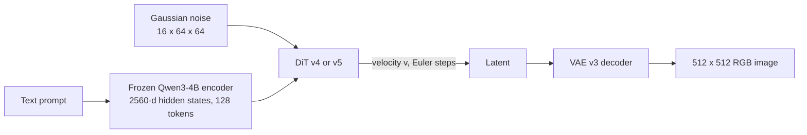

# RAY-IMAGE

RAY-IMAGE is an independent, from-scratch text-to-image research project. It covers a custom
latent autoencoder, a Diffusion Transformer (DiT) trained with flow matching, frozen Qwen3-4B
text conditioning, and classifier-free guidance (CFG). It is developed under a small compute
budget (free-tier Kaggle T4 GPUs), and this repository documents the engineering as it actually
happened, including the failures.

> **Status: experimental research code.** The models train and their losses are logged, but
> sample quality is not yet good enough for public use, and no benchmark has been run. See
> [Results and limitations](#results-and-limitations).

[](https://github.com/Rishidev-20thcenturey/rustes-generative-ai/actions/workflows/test.yml)

---

## Contents

- [Status at a glance](#status-at-a-glance)
- [Model lineage](#model-lineage)
- [Architecture](#architecture)
- [Training pipeline](#training-pipeline)
- [Quick start](#quick-start)
- [Results and limitations](#results-and-limitations)
- [Known issues and open work](#known-issues-and-open-work)
- [Repository layout](#repository-layout)
- [Artifacts and access](#artifacts-and-access)
- [Further documentation](#further-documentation)
- [Contact](#contact)

---

## Status at a glance

| Area | Current state |
|---|---|
| **Active training** | DiT v5 (sparse Mixture-of-Experts). Logged to about 171k steps on the warm-started run. |
| **Baseline** | DiT v4 (dense, 110.7M parameters). Its 120k checkpoint is the warm-start source for v5. |
| **Legacy release** | DiT v3 (about 60M parameters). Reported as trained for 300k steps. Its checkpoint is private (see [Artifacts and access](#artifacts-and-access)). |
| **Autoencoder** | VAE v3 at 512 × 512, 16 latent channels, 64 × 64 latent grid. Its checkpoint is referenced by the training code. |
| **Sampling** | `ray_image/generate.py` loads **v3 checkpoints only**. v4 and v5 are sampled through `ray_image/flow.py` (see [Quick start](#quick-start)). |
| **Quality** | Experimental. Colours and composition vary across prompts, but prompt adherence and object structure are weak. |
| **Release classification** | Research code. Not a production image generator. |

---

## Model lineage

| Version | Architecture | Parameters | Latent grid | Tokens | Training status |
|---|---|---|---|---|---|
| **v3** | Dense DiT, 1D RoPE, 256 px era | ~60M | 16 × 32 × 32 | — | Legacy. Reported 300k steps. Checkpoint private. |
| **v4** | Dense DiT, 2D axial RoPE, RMSNorm, SwiGLU, gated text cross-attention | **110.7M** (`dit_v4.py`; the code name says "100M") | 16 × 64 × 64 | 256 (patch 4) | Baseline. Used as the warm-start source for v5. |
| **v5** | v4 with each SwiGLU FFN replaced by a sparse MoE: 1 shared + 8 routed experts, top-2 routing | **≈482M total**, ≈204M active per token (computed from the config) | 16 × 64 × 64 | 256 (patch 4) | Active training. Last logged step ≈171k. |

The v3 model is in `dit_v3.py` and is the only architecture `generate.py` can load. v4 and v5
share all components with v3 except the blocks noted above.

---

## Architecture

### Generation path (v4 / v5)



Sampling runs Euler integration over the learned velocity field. The loop is in
`ray_image/flow.py` (`euler_sample`). When `cfg_scale > 1`, the model is evaluated twice per step,
with the prompt and with the null prompt, and the two velocities are combined.

### Components

| Component | File | Notes |
|---|---|---|
| Latent autoencoder | `vae_v3.py` | Encodes 512 × 512 RGB to 16 × 64 × 64 latents. Used frozen; latents are precomputed into the cache. |
| Text encoder | `text_encoder.py` | Frozen Qwen3-4B. Hidden states are 2560-d, truncated to 128 tokens. |
| DiT backbone | `dit_v4.py`, `dit_v5_moe.py` | Patch 4 (32 × 32 image pixels per token), 2D axial RoPE on row and column indices, adaptive scale and shift from time and pooled text, gated cross-attention to text tokens. |
| MoE layer (v5) | `dit_v5_moe.py` (`MoELayer`) | Shared SwiGLU expert (always on) plus 8 routed SwiGLU experts with top-2 routing. Capacity factor 1.25; assignments past capacity are dropped, and the token still gets the shared expert and the residual. |
| Objective | `flow.py`, `train_dit_v4.py`, `train_dit_v5.py` | Flow matching with a linear path. Target velocity is `noise − x0`. |
| Regularisers (v5) | `dit_v5_moe.py` | Switch-style load-balancing loss (weight 0.01) and router z-loss (weight 0.001). |
| Null prompt and CFG | `cfg.py` | Caption dropout (10%) during training. The null-prompt embedding is validated before use. |
| EMA | `train_dit_v4.py` | Exponential moving average of weights, decay 0.999. EMA weights are used for sampling. |

### Parameter details

- **v4:** dim 640, depth 14, heads 10, patch 4, SwiGLU hidden 1728. Counted: 110,724,750 parameters.
- **v5:** same backbone, with each FFN replaced by 1 shared expert and 8 routed experts, each with
  hidden size 1728. Router is a small linear layer in fp32. Counted total ≈482M. The active count
  per token is computed from the config and was not measured.

---

## Training pipeline

### Data

Training uses a precomputed cache of 20 chunks of 10,000 samples each (200k in total). Each sample
holds the VAE latent and the Qwen text embedding, so the VAE and the text encoder do not run during
training.

Chunks are loaded in **windows** of 50,000 optimizer steps. At each window boundary:

1. The window's chunk files are deleted from local disk.
2. The hub-cache copy of the chunk repository is purged (see [Known issues](#known-issues-and-open-work)).
3. A replay buffer (default capacity 5,000) is refreshed with samples from the finished window.
4. The next window's chunks are downloaded from the Hugging Face dataset repository.

### Checkpoints

Each run writes two files per save point, every 500 steps:

- a **full** checkpoint (DiT, EMA, optimizer state, step, seed, window index and config) for resuming, and
- an **EMA-only** checkpoint for inference.

| Setting | v4 | v5 |
|---|---|---|
| Local retention | 4 of each kind | 2 of each kind |
| Hugging Face main branch | last 4 of each kind, uploaded every 5,000 steps | same policy |
| Milestones | every 10,000 steps, never deleted | same policy |

Resume (`--resume`) loads with `strict=True` and checks the architecture against the checkpoint's
config (RB-11), so a mismatched model fails loudly rather than loading partially.

### Optimisation

| Setting | Value |
|---|---|
| Optimizer | AdamW, betas (0.9, 0.99), weight decay 0.01 |
| Learning rate | 5e-5 (`--lr`), linear warmup over 500 steps in v4 |
| Gradient clipping | global norm 1.0 |
| Batch size | 8 by default. The v5 Kaggle run uses 4 to fit a T4. |
| Precision | fp16 autocast on CUDA. **v5 adds a `GradScaler`; v4 does not** (see [Known issues](#known-issues-and-open-work)). |
| Guards | Non-finite loss or gradient norm skips the step and is counted. Corrupted weights are not saved. |

### Warm start (v5)

`--warm-start-from <v4 checkpoint>` copies the v4 FFN into every routed and shared expert. The
down-projections are scaled by 0.5, so that at initialisation the MoE output equals the dense FFN
output (routing weights sum to 1). Training continues from the v4 step counter. The LR ramps
linearly from 0 to the target over `--warmup-steps` (default 1000). The router keeps its fresh
initialisation, and the optimizer state and replay buffer start empty.

---

## Quick start

### 1. Environment

```bash
git clone https://github.com/Rishidev-20thcenturey/rustes-generative-ai.git
cd rustes-generative-ai
python -m venv .venv && source .venv/bin/activate
pip install -r requirements.txt
```

`requirements.txt` does not pin exact versions. Use torch 2.5 or newer; the v5 code uses
`torch.amp.GradScaler`.

### 2. CPU smoke checks

These are the checks CI runs (`.github/workflows/test.yml`). Run them from the repository root:

```bash
export PYTHONPATH=.
python -m ray_image.train_smoke
python -m ray_image.probe_smoke
python -m ray_image.whiten_smoke
python -m ray_image.probe_text_smoke
python -m ray_image.n4_smoke
python -m ray_image.n5_smoke
python -m ray_image.resume_smoke
python -m ray_image.cfg_smoke
```

The DiT v4 smoke test is run by hand, not by CI:

```bash
python -m ray_image.dit_v4_smoke
```

No committed smoke test exists yet for the v5 MoE code. See [Known issues](#known-issues-and-open-work).

### 3. Build the training cache (GPU)

```bash
python -m ray_image.precompute_cache_v4 --help
```

The builder writes 10,000-sample chunks and can upload them to a Hugging Face dataset repository.
Use `--start-chunk` and `--end-chunk` to build a subset.

### 4. Train

DiT v4 (dense baseline):

```bash
python -u -m ray_image.train_dit_v4 \
    --cache-path /path/to/cache \
    --steps 500000 --batch-size 8 \
    --output-dir /path/to/checkpoints
```

DiT v5 (MoE), warm-started from a v4 checkpoint:

```bash
python -u -m ray_image.train_dit_v5 \
    --warm-start-from /path/to/ray_dit_v4_step_0120000.pt \
    --warmup-steps 1000 \
    --steps 500000 --batch-size 4 \
    --cache-path /path/to/cache \
    --output-dir /path/to/checkpoints
```

Useful flags for v5: `--num-experts`, `--top-k`, `--expert-hidden-dim`, `--capacity-factor`,
`--aux-loss-weight`, `--z-loss-weight`. Resume an interrupted run with `--resume <full .pt>`.
Add `--no-hf-upload` for a local-only run. Set `HF_TOKEN` if you upload.

### 5. Sample

**v3 checkpoints** (the only ones the bundled sampler supports):

```bash
python -m ray_image.generate \
    --checkpoint ray_dit_v3_ema_step_XXXXXXX.pt --use-ema \
    --vae-checkpoint <vae.pt> \
    --prompt "a watercolor harbour at dusk" \
    --steps 40 --cfg-scale 3.0 --output out.png
```

**v4 and v5 checkpoints** do not yet have a committed command-line sampler. The building blocks are:

- `ray_image.flow.euler_sample(model, text, shape, steps, text_mask, cfg_scale, null_text, null_mask)`
- `RAYDiT_v5.predict_velocity(z, t, text, text_mask)`, which returns the velocity tensor only.
  `euler_sample` uses it automatically when present, and unpacks a tuple from `forward` otherwise.

The latents from v4 and v5 are used raw (`LATENT_SPACE = "raw"`), so no un-whitening step is needed,
but the decoder must be VAE v3 at 512 px.

---

## Results and limitations

### What the logs show

- **v4 (dense):** training loss fell from about 3.2 at step 3k to about 2.5 at step 10k. The later
  v4 logs and the 120k checkpoint are the warm-start source.
- **v5 (MoE):** the logged loss was about 1.5 near 127k steps and about 1.4 near 170k. The
  velocity MSE moved from about 1.5 to about 1.35 over that range. This is a small improvement.
- **Routing:** the load-balancing term stays near 1.1, which means a balanced router and no expert
  collapse. Capacity drops are about 7% of assignments on average, varying from 3% to 19% per
  logging interval. The router z-loss fell from about 1.5 to about 0.25 over the same range,
  meaning the router logits became smaller and routing softer.
- **EMA drift** held at about 0.0007 throughout, so the weights were still moving slowly.

These numbers come from training logs read by eye, not from a formal evaluation.

### What the samples show

- Early v4 samples show more prompt-specific colour and composition than the v5 samples reviewed so
  far. Object structure is weak in both.
- At 135k steps, v5 samples on a 15-prompt grid share much of their composition across prompts
  (dark upper area, light patch lower left). Prompt adherence looks weak.
- The 170k v5 checkpoint has not been sampled and reviewed yet.

### What has not been established

- No CLIP-score, FID, or human-preference benchmark has been run for any model in this repository.
- Whether the text conditioning is steering the output has not been tested directly. The planned
  test compares the velocity with the real prompt against the velocity with the null prompt, at
  the same noise and timestep. If the two are near-identical, the model is ignoring the text.
- The v3 "300k steps" figure comes from the project's earlier records. It cannot be reproduced from
  this repository, because the checkpoint is private.

---

## Known issues and open work

Listed in rough priority order.

1. **Text conditioning may be too weak.** See the test in [What has not been established](#what-has-not-been-established).
2. **Sampling for v4 and v5 is not a committed CLI.** `generate.py` builds only the v3 model. The
   v5 Kaggle inference script lives outside the repository.
3. **v4 training has no `GradScaler`.** fp16 autocast without loss scaling can underflow small
   gradients. v5 adds one. Port it to v4 before the next v4 run.
4. **Hub-cache purge is unverified on Kaggle.** `hf_hub_download(..., local_dir=...)` writes into
   `local_dir` and does not create the hub-cache copy. `Window.release()` purges the chunk repo's
   hub-cache folder at each window end to remove copies left by other processes. Whether this
   fixes the disk growth seen on Kaggle has not been confirmed. Interrupted downloads can also leave
   `.incomplete` files under `local_dir/.cache/huggingface/`, and those are not removed.
5. **Router z-loss has dropped about 6× over training.** Routing still looks balanced, but the
   softer routing may slow expert specialisation. Watch it.
6. **Capacity drops.** About 7% of routed assignments are dropped on average. A higher
   `--capacity-factor` (for example 1.5 or 2.0) is the first thing to try. Track fully-dropped tokens,
   not just assignments.
7. **Patch size.** A 4 × 4 latent patch covers 32 × 32 image pixels. Patch 2 would give 1024 tokens,
   which is about four times the attention cost and is hard to fit on a T4 at this model size.
8. **No committed v5 smoke test.** The v5 forward, routing, warm start, and resume checks were run
   from a script outside the repository. Commit them as a smoke test, and add them to CI.
9. **CI does not cover v4 or v5 code.** CI runs the eight smoke modules listed in Quick start. None of them exercise `train_dit_v4`, `train_dit_v5`, or `dit_v5_moe`.
10. **Warm-start optimizer state.** Adam moments start empty at the warm start. The LR ramp
    mitigates the resulting loss spike, but it is not verified against an unramped run.
11. **Disk budget.** A full v5 checkpoint is about 7.7 GB and the EMA file about 1.9 GB. Local
    retention of 2 keeps the working set near 19 GB before cache chunks.

---

## Repository layout

```
ray_image/
  # Models
  vae_v3.py, vae_v2.py, vae.py          Autoencoders (v3 is the one used by v4 and v5)
  dit_v5_moe.py                         DiT v5: sparse MoE, warm start, predict_velocity
  dit_v4.py                             DiT v4: dense 110.7M baseline
  dit_v3.py, dit_v2.py, dit.py          Earlier DiT versions (v3 is the legacy release)
  text_encoder.py                       Frozen Qwen3-4B text encoder

  # Training and data
  train_dit_v5.py                       v5 trainer (MoE, warm start, GradScaler, LR ramp)
  train_dit_v4.py                       v4 trainer; also provides Window, ReplayBuffer, checkpoint helpers
  train_dit_v3.py, train_vae_v3*.py     v3 trainers
  precompute_cache_v4.py                Builds the v4 latent and text cache (512 px)
  precompute_qwen_cache.py              Earlier cache builder
  cfg.py                                Null prompt, caption dropout, EMA helpers

  # Sampling
  flow.py                               Flow-matching helpers and euler_sample (v4 and v5 path)
  generate.py                           Command-line sampler (v3 checkpoints only)
  whiten.py                             Latent statistics for the v3 path

  # Probes and smoke tests (CI runs the ones listed in Quick start)
  *_smoke.py, probe_*.py, evaluate.py

tools/                                  Toy dataset and evaluation utilities
notebooks/                              Colab notebooks from earlier phases
runs/                                   Saved outputs from an earlier phase (N5.1)
assets/                                 Hero graphic (SVG)
.github/workflows/test.yml              CPU smoke checks
```

Documents at the repository root:

- `README.md`: this file.
- `PROJECT_STATE.md`: phase log. Written before v4 and v5, so it is partly out of date.
- `KAGGLE_SETUP.md`: Kaggle setup and launch notes. Written for v3 and partly out of date.
- `REPO_AUDIT_README.md`: an earlier audit of the codebase. It is historical and does not reflect
  v4 or v5.

---

## Artifacts and access

Large weights, datasets, and caches live on Hugging Face, not in Git. A link is a location reference,
not a statement that the files are public or compatible with each other.

| Artifact | Repository | Notes |
|---|---|---|
| v3 model (legacy, ~60M) | [Rishix500/ray-image-dit-n8-v3](https://huggingface.co/Rishix500/ray-image-dit-n8-v3) | Private at the time of writing. |
| v2 model | [Rishix500/ray-image-dit-n8-v2](https://huggingface.co/Rishix500/ray-image-dit-n8-v2) | Earlier artifact. |
| v4 model (dense, 110.7M) | `Rishix500/ray-image-dit-v4-100m-512` (referenced by `train_dit_v4.py`) | Milestones: `…-milestones`. |
| v5 model (MoE) | `Rishix500/ray-image-dit-v5-moe` (referenced by `train_dit_v5.py`) | Milestones: `…-moe-milestones`. |
| VAE v3 (512 px) | `Rishix500/ray-image-vae-v3-512` (referenced by the trainers) | Checkpoint `ray_vae_v3_step_0030000.pt`. |
| Training cache (v4, 200k) | [Rishix500/monet-qwen-cache-200k-v4](https://huggingface.co/datasets/Rishix500/monet-qwen-cache-200k-v4) | Default `--cache-repo`. |
| Earlier cache (200k) | [Rishix500/monet-qwen-cache-200k](https://huggingface.co/datasets/Rishix500/monet-qwen-cache-200k) | Earlier format. |

Access to the v4, v5, and VAE repositories has not been verified here; check their visibility before
linking them publicly.

The repository has **no `LICENSE` file**, so no license is granted by default. Add one before any
redistribution.

---

## Further documentation

Design decisions for the MoE architecture, the warm-start scaling, the LR ramp, and the checkpoint
policy are recorded in the commit messages on this branch (`git log --oneline`). Read them with the
code.

---

## Contact

For RAY-IMAGE questions, research feedback, or technical collaboration:

**Email:** [rishirajc406@gmail.com](mailto:rishirajc406@gmail.com)

---

<p align="center">
  <sub>RAY-IMAGE · independent text-to-image research under constrained compute</sub>
</p>
