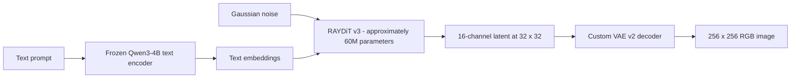

<!-- RAY-IMAGE README: model overview, release status, engineering history, and reproducibility notes. -->

  

  
  
  
  
  

<h1 align="center">RAY-IMAGE</h1>

  <strong>An independently developed text-to-image system, evolving from a ~60M dense DiT to a 110.7M dense model and a ~482M sparse-MoE architecture.</strong>
   
  Custom VAE · Diffusion Transformers · Flow Matching · Qwen3-4B Conditioning · Classifier-Free Guidance

  <a href="#-the-60m-release-milestone">Release milestone</a> ·
  <a href="#-architecture">Architecture</a> ·
  <a href="#-engineering-timeline">Engineering timeline</a> ·
  <a href="#-what-the-model-can-and-cannot-do">Results and limits</a> ·
  <a href="#-reproduce-and-inspect">Reproduce and inspect</a>

---

## RAY-IMAGE — what I build

RAY-IMAGE is my independently developed text-to-image research system. I design and implement its model architectures, latent-image pipeline, training code, text-conditioning path, data preparation, checkpoint workflow, and inference components. The project is built under constrained compute using free-tier Kaggle T4 GPUs, with each model generation extending the previous engineering baseline.

The development line has progressed through three major DiT generations: **v3**, a ~60M dense model that established the initial real-image pipeline; **v4**, a counted 110,724,750-parameter dense model at 512 × 512; and **v5**, a roughly 482M-parameter sparse Mixture-of-Experts model warm-started from v4. The current technical details and training evidence are documented below.

### v3 foundation

v3 established the first complete real-image generation path: a custom VAE, a text-conditioned DiT, flow-matching velocity prediction, cached Qwen3-4B embeddings, and Euler sampling with optional classifier-free guidance.

| Area | v3 baseline |
|---|---|
| **DiT size** | Approximately 60M parameters |
| **Reported training milestone** | 300,000 optimizer steps |
| **Image path** | 256 × 256 RGB through a custom 16-channel VAE latent |
| **Text conditioning** | Frozen Qwen3-4B encoder; 2,560-dimensional hidden states |
| **Training objective** | Flow matching / velocity prediction |
| **Sampling** | Euler integration; optional classifier-free guidance |
| **Training engineering** | Warmup, gradient clipping, finite-value guards, checkpoint provenance and resume validation |
| **Conditioning and averaging** | Caption dropout, null-prompt path, and exponential moving average (EMA) |

The v3 checkpoint is a private artifact. The later v4/v5 work builds on the engineering lessons and system design established in this baseline.

## Current research status — 6 November 2026

RAY-IMAGE has moved beyond the original v3 baseline. I developed v4 as a higher-resolution dense DiT, then used its 120k checkpoint to warm-start v5 and introduce sparse expert capacity while preserving the dense model's initial function.

The `main` branch preserves the v3 source snapshot as the repository's historical baseline. This README brings the later v4/v5 architecture and training record together with that baseline, while keeping source-code history and model-generation history clearly distinguished.

### Model lineage

| Version | Architecture | Parameters | Development status |
|---|---|---:|---|
| **v3** | Dense DiT | ~60M | Earlier real-image baseline; 300k-step training milestone. |
| **v4** | Dense DiT with 2D axial RoPE, SwiGLU, and gated text cross-attention | **110,724,750 counted** | Trained; its 120k checkpoint provides the v5 warm start. |
| **v5** | v4 backbone with sparse MoE FFNs: 1 shared + 8 routed SwiGLU experts, top-2 routing | **~482M total; ~204M active/token (computed)** | Active training record reached approximately 171.4k steps. |

### Shared v4/v5 system configuration

- **Image and latent path:** 512 × 512 RGB, custom VAE v3, 16 latent channels, 64 × 64 latent grid.
- **Tokenisation:** patch size 4, producing 256 tokens; each token corresponds to a 32 × 32 region of the output image.
- **Text path:** frozen Qwen3-4B hidden states, 2,560 dimensions, truncated to 128 tokens.
- **Training objective:** flow matching with velocity prediction.
- **Sampling path:** Euler integration over the learned velocity field, with optional classifier-free guidance.

### v5 architecture and warm start

I replaced each v4 SwiGLU feed-forward block with a sparse MoE layer containing **one shared expert and eight routed experts**. Top-2 routing selects the routed experts for each token. The v4 FFN weights were copied into all nine experts, with down-projections scaled by 0.5 so the MoE output initially matches the dense FFN output.

The v5 run starts from the v4 120k checkpoint and uses a 1,000-step learning-rate ramp. The optimizer state and replay buffer start fresh for the MoE phase. This gives the new architecture a controlled transition from the trained dense baseline.

### v5 training report

| Signal | Recorded result | Engineering interpretation |
|---|---|---|
| **Training loss** | ~1.5 near 127k steps; ~1.4 near 170k | Continued optimisation with a modest improvement; the last ~40k steps show a flatter trend. |
| **Velocity MSE** | ~1.5 to ~1.35 | A small improvement in the velocity-prediction objective. |
| **Load balancing** | Load-balance term near 1.1 | Routing remains balanced; no expert collapse has been observed in the reported logs. |
| **Capacity drops** | ~7% of assignments on average; ~3%–19% by logging interval | Capacity is an active tuning variable; the next comparison will measure fully-dropped tokens as well as assignments. |
| **Router z-loss** | ~1.5 down to ~0.25 | Router logits have become smaller and routing softer; this is being monitored alongside expert utilisation. |
| **EMA drift** | ~0.0007 | A weight-stability diagnostic tracked during training. |

I use the loss, velocity MSE, routing statistics, and EMA drift to monitor optimisation and MoE behaviour. They are training diagnostics; visual quality is assessed separately through generated samples.

### Sample review and current model behaviour

- **v4:** the reviewed samples show more prompt-specific colour and composition than the v5 samples reviewed so far. Object structure still needs improvement.
- **v5 at 135k:** the 15-prompt grid showed repeated composition patterns and weak prompt separation. In a separate three-prompt comparison, “blue sky with white clouds” was the clearest match.
- **v5 around 170k:** the checkpoint is recorded in the model repository; the matched sample review is the next checkpoint comparison.

**Current assessment:** the v5 training system is running with balanced expert routing and a modest improvement in velocity loss. The main generation challenge is now improving text-driven composition and recognisable object structure. That is the focus of the next validation cycle.

### Next validation experiments

1. **Measure text steering:** compare predicted velocity for a real prompt and the null prompt at the same noise and timestep. This quantifies how strongly the conditioning path changes the model's prediction.
2. **Compare v5 checkpoints:** generate the same prompts and seeds for the 135k and ~170k checkpoints.
3. **Tune MoE capacity:** compare capacity factors such as 1.5 and 2.0; track dropped assignments and fully-dropped tokens.
4. **Strengthen v4/v5 test coverage:** add committed smoke tests for forward passes, routing, warm start, checkpoint resume, and sampling, then include them in CI.
5. **Harden Kaggle data handling:** verify cache cleanup across session windows and handle interrupted-download remnants.
6. **Compare warm-start schedules:** measure the current 1,000-step ramp against a controlled alternative.
7. **Complete the v4/v5 inference interface:** provide a reproducible command-line sampling path using the matching model and VAE artifacts.
8. **Build a repeatable quality evaluation:** use fixed prompts and seeds, a structured visual review, and quantitative metrics when the evaluation protocol is ready.

### Hugging Face artifacts and access

The following visibility checks were made against Hugging Face repository metadata on **6 November 2026**. Private repositories are identified for artifact provenance; only public repositories are linked as downloadable resources.

| Artifact | Repository | Access |
|---|---|---|
| **v5 MoE main** | [Rishix500/ray-image-dit-v5-moe](https://huggingface.co/Rishix500/ray-image-dit-v5-moe) | **Public**; project records identify the ~170k checkpoint. |
| **v5 milestones** | `Rishix500/ray-image-dit-v5-moe-milestones` | Private. |
| **v4 dense model** | `Rishix500/ray-image-dit-v4-100m-512` | Private. |
| **v4 milestones** | `Rishix500/ray-image-dit-v4-100m-512-milestones` | Private. |
| **VAE v3 at 512px** | `Rishix500/ray-image-vae-v3-512` | Private. |
| **Legacy v3 model** | `Rishix500/ray-image-dit-n8-v3` | Private. |
| **MONET + Qwen cache** | [Rishix500/monet-qwen-cache-200k-v4](https://huggingface.co/datasets/Rishix500/monet-qwen-cache-200k-v4) | Public; its dataset card reports **140,000 samples** despite the historical “200k” name. |

A public checkpoint repository and its companion VAE, milestone files, and datasets have separate access controls. Check the matching artifact permissions and model configuration before running inference.

## 🖼️ v3 sample gallery — historical baseline

The image above contains genuine outputs generated during the v3 development stage, using prompts such as desert dunes, a nebula, ocean waves, forests, a glacier, and abstract watercolor. It documents the visual baseline that informed the subsequent v4 and v5 architecture iterations.

The v3 samples demonstrate the end-to-end generation path and its ability to respond to broad prompt themes. They also show the specific quality target that motivated later work: stronger object structure, clearer prompt separation, and more consistent scene composition. The newer v4/v5 checkpoints are evaluated separately from this historical gallery.

## ◈ v3 architecture — original implementation baseline

The following diagram and source map describe the v3 implementation preserved on the `main` branch. The model-development record above tracks the later v4 and v5 architecture advances.

### Target generation path

The diagram describes the intended v3 generation route. A checkpoint, VAE, latent-space convention, text-conditioning shape, and architecture configuration must match for inference. Not every historical checkpoint is compatible with the current generation entry point.

### Model components

| Component | Design and role | Source |
|---|---|---|
| **VAE v2** | Custom encoder/decoder; 256 × 256 RGB image to a 16 × 32 × 32 latent and back | [ray_image/vae_v2.py](ray_image/vae_v2.py) |
| **DiT v3** | 512 model width, 12 transformer blocks, 8 attention heads, patch size 2; RoPE self-attention, RMSNorm, SwiGLU and gated text cross-attention | [ray_image/dit_v3.py](ray_image/dit_v3.py) |
| **Text encoder** | Frozen Qwen3-4B representations with 2,560 hidden dimensions; optional 8-bit loading | [ray_image/text_encoder.py](ray_image/text_encoder.py) |
| **Flow matching** | Linear interpolation between data latents and Gaussian noise; velocity-prediction objective | [ray_image/flow.py](ray_image/flow.py) |
| **Caption dropout / null prompt** | Replaces a proportion of training conditions with a null placeholder so unconditional and conditional predictions can be combined | [ray_image/cfg.py](ray_image/cfg.py) |
| **EMA** | Maintains an exponential moving average of DiT weights for a smoother inference candidate | [ray_image/cfg.py](ray_image/cfg.py) |
| **Training** | Streams MONET examples or reads precomputed latents and text embeddings; validates resume configuration and protects checkpoint writes | [ray_image/train_dit_v3.py](ray_image/train_dit_v3.py) |
| **Cache builder** | Precomputes VAE latents and Qwen hidden states in chunks to reduce repeated encoder work during training | [ray_image/precompute_qwen_cache.py](ray_image/precompute_qwen_cache.py) |
| **Inference** | Loads compatible v3 checkpoints, optionally uses EMA and CFG, and checks checkpoint/latent whitening metadata | [ray_image/generate.py](ray_image/generate.py) |

### Training recipe recorded in the code

| Setting | Value or behaviour |
|---|---|
| Training resolution | 256 × 256 RGB |
| Latent tensor | 16 channels × 32 × 32 |
| DiT width / depth / heads | 512 / 12 / 8 |
| Base learning rate | 5e-5 |
| Warmup | 500 steps |
| Gradient clipping | Maximum norm 1.0 |
| Training precision | DiT forward path uses FP16 |
| Caption dropout | Default probability 0.10 |
| EMA decay | Default 0.999 |
| Checkpoint/log cadence | 500 / 100 steps in the current training script |
| Data source | MONET (jasperai/monet) or precomputed cache |
| Cached text shape | Dataset card describes 47 × 2,560 text embeddings per cached item |

These settings describe the current code/configuration and the recipe recorded in the project audit. They are not a claim that every run has identical environments or bit-for-bit reproducibility.

## 🧱 Engineering timeline

### 1. Foundation: toy latents and shape probes (N0–N7)

The first stages focused on proving the model path with toy images and simple coloured shapes before using real images. The VAE path evolved from a smaller four-channel latent setup to a 16-channel representation for the 256-pixel pipeline.

A low shape-accuracy score initially pointed attention at the model, but a probe exposed a problem in the evaluation metric: corner occupancy was measured against the whole image instead of the object bounding box. The lesson was not to trust a score until the measurement is calibrated against the image geometry it is supposed to measure.

### 2. Scaling to real images (N8)

The project moved to the MONET image-caption dataset and a 256 × 256 path. VAE v2 and its 47,500-step checkpoint became part of the training pipeline.

The first larger DiT v2 experiment, approximately 180M parameters, reportedly diverged into NaNs around 12,000 steps. That consumed significant iteration time and showed that parameter count alone does not make a training run better. The project moved to a smaller DiT v3 and focused on stability before further scaling.

### 3. Rebuilding the training recipe around DiT v3

The current v3 code uses a smaller model with RMSNorm, SwiGLU, RoPE self-attention, FP16 forward computation, warmup, gradient clipping, and NaN/finite-checkpoint guards. The project run notes report successful progression through 100k, 200k, and 300k steps.

This should be read as evidence that the reported training run progressed to those milestones—not evidence that the generated images are already high quality. A loss curve or a successful optimizer loop cannot substitute for a held-out image-quality evaluation.

### 4. Building the latent/text cache pipeline

The data path precomputes VAE latents and Qwen text embeddings so that repeated DiT training steps do not need to run both encoders on every image. The cache builder supports resumable 10,000-sample chunks and range-selection arguments.

Two issues shaped this part of the project:

- A brittle source-code string replacement intended to alter a stream offset did not match the actual numeric formatting. It was replaced by explicit chunk/range command-line arguments.
- The project notes report a corrupted MONET Parquet shard around source position 191k. The affected 190k–200k range was skipped instead of silently treated as valid cache data. The cache pipeline can handle individual failures, but upstream dataset integrity remains an external dependency.

The public cache repository is a separately hosted artifact; it is not bundled in this Git repository.

### 5. Adding conditioning and sampling controls

The current code includes caption dropout, a null-prompt embedding path, EMA tracking, and CFG sampling. These changes address real training/inference gaps: CFG requires an unconditional path learned during training, and sampling must use conditioning and latent transformations consistently with the checkpoint.

The code also logs a zero-prediction MSE baseline so loss values can be interpreted against a simple reference. This helps diagnose optimisation behaviour, but it is not a measure of semantic alignment or image quality.

### 6. Hardening checkpoints and the inference path

The repository includes multiple defensive changes:

- checkpoint configuration records architecture and provenance information such as latent-space convention, text cap, VAE checkpoint, PyTorch version, and run identity;
- resume validation checks that essential architecture fields match the checkpoint before training continues;
- latent un-whitening is applied only when the checkpoint stores the corresponding whitening state, rather than guessing from a default stats file;
- the generation path explicitly refuses the known-incompatible legacy `generator_v0.3` stage;
- NaN and non-finite checks help prevent corrupted weights from being saved;
- checkpoint cleanup uses separate windows for full resume checkpoints and EMA checkpoints.

These safeguards improve diagnosis and reduce avoidable incompatibility. They do not guarantee that an arbitrary external checkpoint will load or produce good images.

## 🧰 Engineering decisions and system improvements

| Engineering challenge | What it exposed | Design or implementation response |
|---|---|---|
| **DiT v2 divergence** | The larger ~180M experiment became numerically unstable; the reported run hit NaNs near 12k steps | Moved to v3 and adopted a stability-first recipe: lower learning rate, warmup, gradient clipping, RMSNorm, SwiGLU, FP16 and finite-value guards |
| **Uncalibrated toy evaluator** | The shape metric's corner-occupancy logic did not measure the object geometry correctly | Added a shape probe and corrected the interpretation of the score before using it to judge model behaviour |
| **Silent cache-range edit failure** | String replacement missed a source expression because of numeric formatting | Replaced hidden source edits with explicit chunk-range CLI arguments |
| **Missing unconditional training path in an earlier recipe** | CFG requires training examples with dropped conditions and a defined null prompt | Added caption dropout, null-prompt handling, EMA and a CFG-capable sampler to the current code path |
| **Latent whitening mismatch** | Training and generation could disagree about whether latents were raw or transformed | Record latent-space provenance and reject unverifiable or contradictory whitening transformations |
| **Legacy model-construction mismatch** | Old generator stages and current v3 model contracts were not interchangeable | Explicitly refuse the unsupported legacy stage and use a matching VAE/DiT route |
| **Qwen placement on constrained multi-GPU sessions** | Automatic device mapping could distribute the text encoder unexpectedly in the Kaggle setup | Configure the text encoder for the intended single-device path and document setup assumptions |
| **Kaggle package/ABI drift** | Installed PyTorch, torchvision and Transformers versions could disagree or leave stale modules in a live kernel | Document the environment-reset and package setup procedure in [KAGGLE_SETUP.md](KAGGLE_SETUP.md) |
| **Credentials and ephemeral sessions** | Environment variables do not survive fresh hosted sessions, and credentials should not be written into source or logs | Load secrets from environment variables at session start; never commit tokens or print them |
| **Ambiguous checkpoints** | A weight file without stage/config provenance can be loaded through the wrong architecture | Store metadata, validate resume configuration and retain separate names for full and EMA checkpoints |

## 📊 What the legacy v3 results mean — and do not mean

### What has been achieved

- A custom VAE v2 and a larger latent representation for the 256 × 256 image-generation path.
- A custom, text-conditioned DiT v3 architecture with a reported size of roughly 60M parameters.
- A cached data route for VAE latents and Qwen text embeddings.
- Training code with flow matching, caption dropout, null-prompt handling, EMA, gradient clipping and numerical guards.
- A generation entry point with optional CFG and EMA loading for compatible v3 checkpoints.
- Checkpoint provenance/resume checks, latent-whitening validation and CPU smoke modules wired into GitHub Actions.
- A reported 300,000-step training milestone and a ten-prompt gallery showing real experimental outputs.

### What has not been demonstrated yet

- Consistently recognizable faces, animals, everyday objects or exact scene geometry.
- A reproducible benchmark showing prompt adherence or quality against established generators.
- CLIP-score or FID evaluation on a fixed, held-out prompt/image set.
- Published PSNR/SSIM measurements for VAE reconstruction quality.
- Bit-for-bit reproducibility across restarts and environments.
- Stable, production-ready performance for every prompt, checkpoint, or hardware setup.

### The latent-resolution bottleneck

The current VAE compresses a 256 × 256 image into a 16 × 32 × 32 latent tensor. That compact spatial grid is a plausible constraint on fine geometry and small-object detail, and the current samples show weak object recognizability. This is an engineering hypothesis supported by the observed output pattern—not a proven mathematical ceiling. The next experiments need controlled comparisons to establish whether greater spatial resolution, different data/conditioning, training changes, or a combination gives measurable improvement.

## 🔬 Reproducibility and release engineering

The project is experimental research code. Important remaining risks are documented rather than hidden:

1. **EMA on resume:** the current training code recreates EMA from the resumed model weights instead of restoring the saved EMA state. A resumed run therefore does not continue the exact previous EMA trajectory.
2. **Random-state reproducibility:** the checkpoint records a seed and run metadata, but the project audit notes that full RNG state is not persisted for bit-for-bit continuation.
3. **Caption-length analysis:** the cache uses a 47-token text representation. Caption-length percentiles and the impact of truncation have not yet been measured systematically.
4. **Mixed-precision scaling:** no GradScaler path is documented in the current recipe; NaN guards reduce some risks but do not replace a precision/evaluation study.
5. **Dataset integrity:** the reported corrupted upstream Parquet range was skipped. Future runs should validate cache completeness and source ranges instead of assuming every range exists.
6. **Evaluation:** there is no complete CLIP/FID benchmark harness or fixed held-out evaluation protocol in this release.
7. **Dependency pinning:** requirements specify minimum package versions rather than a fully locked environment. Exact reproduction requires recording actual versions, hardware and run settings.
8. **Checkpoint access:** N8 v3 is currently private on Hugging Face. Public code, public examples and downloadable model weights are separate release concerns.

## 🤗 Models and datasets

- **Current v5 MoE model repository (public):** [ray-image-dit-v5-moe](https://huggingface.co/Rishix500/ray-image-dit-v5-moe)
- **v5 milestones (private):** `Rishix500/ray-image-dit-v5-moe-milestones`
- **v4 dense model and milestones (private):** `Rishix500/ray-image-dit-v4-100m-512` and `Rishix500/ray-image-dit-v4-100m-512-milestones`
- **VAE v3 at 512px (private):** `Rishix500/ray-image-vae-v3-512`
- **Legacy v3 model (private):** `Rishix500/ray-image-dit-n8-v3`
- **Public MONET + Qwen cache:** [monet-qwen-cache-200k-v4](https://huggingface.co/datasets/Rishix500/monet-qwen-cache-200k-v4) — its dataset card reports 140,000 samples; the “200k” name is historical.
- **Earlier artifacts:** [ray-image-dit-n8-v2](https://huggingface.co/Rishix500/ray-image-dit-n8-v2), [ray-image-vae-n8](https://huggingface.co/Rishix500/ray-image-vae-n8). Their current visibility was not re-verified in this update.
- **Author profile:** [Rishix500 on Hugging Face](https://huggingface.co/Rishix500)

Large weights, caches and runtime artifacts intentionally live outside Git. A link is a location reference, not proof of public access, compatibility, or image quality. Visibility in the table reflects the metadata check performed on 6 November 2026.

## ⚙️ Reproduce and inspect

### 1. Clone the repository

~~~bash
git clone https://github.com/Rishidev-20thcenturey/rustes-generative-ai.git
cd rustes-generative-ai
~~~

### 2. Prepare Python

The GitHub Actions workflow uses Python 3.11. GPU runs additionally require a compatible PyTorch/CUDA environment, sufficient GPU memory, access to the Hugging Face assets, and—when downloading or uploading private artifacts—a valid HF token supplied through the environment.

~~~bash
python -m venv .venv
source .venv/bin/activate
python -m pip install --upgrade pip
python -m pip install -r requirements.txt
~~~

For hosted Kaggle sessions, read [KAGGLE_SETUP.md](KAGGLE_SETUP.md) before installing or importing the ML stack. Incompatible preinstalled binary wheels and stale notebook-kernel imports caused repeated environment failures during development. Follow the documented restart and dependency steps rather than assuming a fresh session starts with a compatible environment.

### 3. Run the CPU smoke checks

Run from the repository root after installing dependencies. These are small behaviour and wiring checks; they do not train the model or certify image quality.

~~~bash
python -m ray_image.train_smoke
python -m ray_image.probe_smoke
python -m ray_image.whiten_smoke
python -m ray_image.probe_text_smoke
python -m ray_image.n4_smoke
python -m ray_image.n5_smoke
python -m ray_image.resume_smoke
python -m ray_image.cfg_smoke
~~~

The workflow definition is [.github/workflows/test.yml](.github/workflows/test.yml). Check the live Actions badge for the current status; the existence of a workflow is not, by itself, proof that the latest run passed.

### 4. Inspect the training interfaces

~~~bash
python -m ray_image.train_vae_v2 --help
python -m ray_image.train_dit_v2 --help
python -m ray_image.train_dit_v3 --help
python -m ray_image.precompute_qwen_cache --help
~~~

The v3 trainer requires CUDA. Use its current CLI for cache ranges, checkpoint resume, save paths and step targets. Do not hard-code a dataset offset through source-string replacement; inspect the intended range and use the supported arguments.

### 5. Generation interface

A matching v3 EMA checkpoint, the corresponding VAE checkpoint, text-conditioning artifacts and compatible runtime are required. This example shows the interface; it is not a claim that any arbitrary set of downloaded files will work:

~~~bash
python -m ray_image.generate \
  --checkpoint /path/to/ray_dit_v3_ema_step_0300000.pt \
  --use-ema \
  --vae-checkpoint /path/to/ray_vae_v2_step_0047500.pt \
  --prompt "a watercolor harbour at dusk" \
  --cfg-scale 3.0 \
  --steps 40 \
  --seed 42 \
  --output generated.png
~~~

For CFG, the sampler needs the null-prompt embedding path. The v3 loader checks checkpoint stage and latent-space metadata; use the matching checkpoint/VAE pair and follow the error messages rather than bypassing compatibility checks.

## 🗺️ Next validation priorities

The current research priority is to establish whether v4/v5 are improving prompt-conditioned image generation—not simply to increase parameter count or training steps.

- **Measure text steering:** run the real-prompt versus null-prompt velocity comparison at identical noise and timestep.
- **Review the v5 170k checkpoint:** produce a same-prompt, same-seed comparison against the 135k grid.
- **Improve MoE utilisation:** test higher capacity factors and measure fully-dropped tokens and per-expert routing.
- **Add v4/v5 test coverage:** commit smoke tests for forward passes, routing, warm start, checkpoint resume, and sampling; then extend CI.
- **Harden training operations:** verify Kaggle disk cleanup, handle interrupted-download remnants, and compare warm-start schedules under controlled runs.
- **Complete inference documentation:** provide a reproducible v4/v5 inference entry point and verify access to the matching VAE and other required artifacts.
- **Build a formal evaluation protocol:** fixed prompts and seeds, human review, and suitable quantitative metrics before making quality claims.

These are validation and engineering priorities. Do not describe them as completed until the corresponding test or artifact exists.

## 🗂️ Repository map

~~~text
.
├── ray_image/
│   ├── vae.py, vae_v2.py
│   ├── dit.py, dit_v2.py, dit_v3.py
│   ├── text_encoder.py, flow.py, whiten.py, cfg.py
│   ├── train_vae_v2.py
│   ├── train_dit_v2.py, train_dit_v3.py
│   ├── precompute_qwen_cache.py, generate.py
│   ├── probe_*.py, *_smoke.py
│   └── resume_smoke.py
├── notebooks/
├── runs/N5.1/                 # diagnostic report and oracle artifacts
├── tools/                     # toy data and evaluation helpers
├── assets/ray-image-hero.svg  # architecture/project illustration
├── Screenshot_20261023-175533 (2).png
├── .github/workflows/test.yml
├── KAGGLE_SETUP.md
├── PROJECT_STATE.md           # older phase snapshot
└── REPO_AUDIT_README.md       # dated audit report
~~~

Some source modules represent earlier research phases and are retained for historical comparisons. The v3 route is the current real-image training path; legacy modules and checkpoints should not be mixed with it without checking architecture and stage metadata.

## 📚 Engineering principles learned

1. **Calibrate metrics before interpreting them.** An incorrect evaluator can misdiagnose a model.
2. **Prove stability before scaling.** A smaller model that trains is more useful than a larger model that diverges.
3. **Make data ranges explicit.** Chunk boundaries, cached counts, skipped samples and corruption need auditable records.
4. **Treat training and inference as one contract.** VAE version, latent scaling, text dimensions, checkpoint stage and CFG setup must agree.
5. **A successful run is not a quality benchmark.** Training completion, valid tensor shapes, CPU smoke tests and visually appealing examples each prove different things.
6. **Document the failure, not only the fix.** Setup drift, broken shards, resume limitations and weak geometry are part of the engineering record.

## Contact

For RAY-IMAGE questions, research feedback or technical collaboration:

**Email:** [rishirajc406@gmail.com](mailto:rishirajc406@gmail.com)

---

  <strong>Build carefully. Measure honestly. Scale when the evidence is ready.</strong>
   
  RAY-IMAGE · Independent text-to-image research under constrained compute

